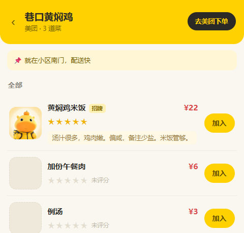

# 探店笔记

自己的探店档案库。**每家店做永久记录**，下次吃饭前先翻一翻，
一眼躲开上次踩雷的，直接奔上次强烈推荐的。

**没有支付、没有配送、没有账号。** 只解决一件事：
「这家到底行不行，下次还去不去」——记下来，别靠脑子。

---

## 怎么跑

```powershell
$py  = 'C:\Users\佟亚龙\.workbuddy\binaries\python\envs\default\Scripts\python.exe'
$dir = 'D:\BaiduSyncdisk\06_github\lulu-order-miniprogram\lulu-family-menu'
& $py -m http.server 8901 --bind 127.0.0.1 --directory $dir
```

打开 **http://127.0.0.1:8901/**

零依赖、零构建。纯 HTML + CSS + 原生 ES Module，
把整个文件夹丢到任何静态服务器都能跑。

---

## 三个页面

| 页面 | 干什么 |
|---|---|
| 💛 **档案** | 按评分分四组的店列表。吃饭前翻这个，看哪家踩雷、哪家值得专程去 |
| 🧾 **清单** | 顺手还能点菜、按店分组照着下单。**附带的**，不是主功能 |
| ⚙️ **管理** | 录店、写一句话总结、改名改价 |

首页按**均分**排成四组，不是按字母也不是按分类：

| 分组 | 阈值 | 长什么样 |
|---|---|---|
| 💛 强烈推荐 | ≥ 4.5 ★ | 卡片左侧金色竖条 |
| 🙂 还可以 | ≥ 3.5 ★ | 绿色竖条 |
| 😐 一般 | ≥ 2.5 ★ | 灰蓝竖条 |
| ⛔ 别再去 | < 2.5 ★ | 浅红底 + 红标题，**最扎眼的一组** |
| ❓ 还没记过 | — | 灰色。「没吃过」和「吃过不好吃」是两回事，别混 |

阈值不是随手定的：5 星「很好吃」、4 星「还不错」、3 星「一般般」、
2 星「不太行」、1 星「难以下咽」。均分 ≥4.5 值得专程去，<2.5 就别了。

**「还没记过」单独一组**，因为它跟差评语义完全不同。
把没吃过混进「别再去」是误导。

---

## 探店记录：去一次记一条

这是整个应用的中心。**不覆盖历史**——每次去都追加一条，
所以能看到「这家我吃过三次，第二次咸了第三次好了」。

**记**
- 店页头部有「记一次探店」按钮，吃饭后随手点
- 清单页每家店分组右下角有「⭐ 记探店」
- 弹层里：**日期 + 星级 + 一句话 + 照片（最多 4 张）**
  - 日期默认今天，可以往前改 —— **补录上个月吃过的也录得进去**
  - 星级默认填上次打的分（大多数时候不用改）
  - 快捷标签（好吃/踩雷/别再点/有点咸…）预勾上次的，点一下取消
- 底部还有保存按钮，不点就不会存

**日期和录入时间是两回事**
- `date` 是**去的那天**，可以改，用来补录历史
- `createdAt` 是**录入的那天**，不能改，用来排时间线顺序

**看**
- 店页头部一颗档位胶囊：`💛 强烈推荐 · 5 ★`
- 下面是时间线，倒序排列，每条带星级、日期、标签、照片、一句话
- 存档库页卡片直接显示均分和去过几次

**为什么存的是「我给的星」而不是平台评分**
外卖平台的评分是所有人的平均值，对你个人没有参考价值。
这里记的是**你自己每次的真实感受**——
「拌面太咸」「这家咸，放一起就对了」这种信息，下单时才真的用得上。

---

## 一句话总结：下次靠这句想起来

每家店可以写**一句话总结**，跟单次记录里的「一句话」不是一回事：

| | 一句话总结 `shop.summary` | 记录里的话 `visit.text` |
|---|---|---|
| 挂在哪 | 店的档案卡片上，一直显示 | 只在那一行记录里 |
| 记什么 | 跨所有次数的**总印象** | 这次吃的**具体情况** |
| 什么时候写 | 吃到第 3 次才写得出来 | 每次随手写 |

一句「黄焖鸡里的标杆。汤足肉嫩，唯一的毛病是咸，备注少盐就完美」，
比看十条「还不错」有用得多。

写的地方：⚙️ 管理 → 对应那家 → 「一句话总结」，输入即自动保存。
首页卡片上会直接显示，写太长自动省略成一行。

---

## 清单页（附带的）

档案库之外还留了点菜功能，因为点菜时能顺手记一次探店，
不用为了记录单独开一个流程。

1. 📋 店页 → 点某道菜「加入」，或者清单页直接加
2. 弹层里选份数、选是谁点的、写备注（不要辣 / 不要香菜）
3. 🧾 清单 → 按店分好组了，一家一家照着点
4. 每家店底下有「去 XX 下单」，直接跳美团/饿了么
5. 下完点「去下单了」，会提示哪几家还没记探店
6. 点「⭐ 记探店」直接补记录

底部导航 🧾 上有红色角标，是清单里已点的份数。

---

## 菜品长什么样

一行就是：**左边一张照片，右边依次是菜名、星级、描述。**



- **没有图标**。以前会用 emoji 占位，但 emoji 看着像某道菜、点进去不是那家的菜，
  认错了比没有更糟，所以宁可不画——没照片就是一块浅色占位。
- 照片自动压到最长边 400px 的 JPEG，一张 30~45KB。
- **菜品星级可以直接点**——店页和管理页都能点，点第 n 颗就是 n 分，
  **再点同一颗取消**。
- 「未评分」和「吃过但不好吃」是两回事：前者是不知道，后者是 1 星、别点了。
- 描述在点菜时会显示在菜名下面，要写成对点菜有用的信息：
  「偏咸，备注少盐」比「很好吃」有用一百倍。

---

## 怎么跳到美团下单

点「去美团下单」时按这个顺序走：

1. 先用 scheme 唤起 App（手机上装了美团就直接跳进 App）
2. 1.6 秒后本页还在前台 → 说明没装 App，回退到网页版

**想一步直达那一家店**，在 ⚙️ 管理 → 那家店 → 填「店铺链接」，
从美团 App 的店铺页「分享 → 复制链接」把地址粘进来。
粘了链接就**直接用你的链接**，不再做 App 唤起。

> 查证记录：美团外卖 H5 是 `https://waimai.meituan.com/`。
> 网上到处流传的 `https://www.meituan.com/waimai/` 是错的，实测直接返回 Not Found。
> 饿了么 H5 `https://h5.ele.me/` 能找店但**不能下单结算**，所以饿了么主要靠 App 唤起。

---

## 界面长什么样

整体是噜噜的芒果黄（`#FFD100`），页头用黄色渐变配白色圆角卡片。

**凡是该放照片的位置一律放真图，没图给中性色占位块，不用 emoji 图标**
——emoji 看着像某道菜，认错了比没有更糟。

噜噜形象一共四张，用在不同地方，不是随便贴的：

| 形象 | 出现在 |
|---|---|
| 正脸头像 | 四个页头的圆形吉祥物、录菜弹层和记探店弹层的头像 |
| 骑电动车送货 | 首页 Banner（铺在右侧，向左渐隐）、清单页页头 |
| 坐着等单 | 空状态：还没点单、店不见了 |
| 系围裙做饭 | 空状态：还没录店、这家没菜、还没记过探店 |

底部导航做了毛玻璃，选中项是黄色胶囊；正文和弹层在桌面上限宽 480px 居中。

---

## 数据在哪

**默认存在浏览器的 localStorage 里**（key: `lulu_family_menu_v1`）。

没配后端时：**换浏览器、换设备、清缓存，数据就没了。**

配了后端之后：数据会额外同步一份到云端，手机电脑看到的是同一份。
做法见 **[docs/接入后端.md](docs/接入后端.md)**——需要一个免费的 Supabase 项目，
没有服务器、没有域名、没有构建。**没配的话应用行为跟现在完全一样。**

判断当前是哪种：⚙️ 管理页标题那里有个小圆点，
`仅本机` / `同步中…` / `已同步` / `云端没连上，先存本地`。

### 数据结构

```js
shop  = { id, name, platform, category, note, rating,
          createdAt, link, image, summary }      // summary = 一句话总结
visit = { id, shopId, orderId, date:'YYYY-MM-DD', // date = 去过的那天，可改
          rating:1-5, text, tags[], images[],     // 一次去一条，只追加不覆盖
          createdAt }                             // 录入的那天，排时间线用
dish  = { id, shopId, name, price, tags[], desc, rating, image, available }
order = { id, createdAt, status:'pending'|'ordered', items[] }
item  = { dishId, shopId, shopName, name, image, price, qty, note, who }
```

> ⚠️ **加字段必须在 `js/store.js` 的 `migrate()` 里补一行。**
> 老数据是从旧版存下来的，没有新加的键，直接读会拿到 undefined，页面一渲染就白屏。

---

## 文件结构

```
lulu-family-menu/
├─ index.html          页面骨架 + 底部导航 + 隐藏的选图 input
├─ css/style.css       全部样式（噜噜芒果黄 #FFD100 + 四档位色）
├─ js/store.js         数据层 + 评分档位 TIERS + migrate   ← 改数据结构动这个
├─ js/app.js           路由 + 四个页面 + 弹层
├─ js/img.js           图片压缩（canvas → 400px JPEG）
├─ js/backend.js       云端同步（没配后端就是空操作）
├─ js/config.js        填 Supabase 的 url 和 key   ← 接后端只动这个
├─ docs/
│   ├─ 接入后端.md     Supabase 建表 SQL + 接入步骤
│   └─ dish-row.jpg    菜品行布局示意
└─ assets/             噜噜形象图（4 张 webp）
```

路由用 hash（`#/shop/s1`），丢到 GitHub Pages 这种没有 rewrite 规则的
静态托管上也能直接跑。

---

## ⚠️ 噜噜形象的版权

本项目**没有**水豚噜噜的正式授权。

- 噜噜出自国产 3D 动画《平头哥》少年篇，著作权方是
  **铁罐(北京)文化传媒有限公司**，运营方「元气造物」。
- `assets/` 里那四张 webp 是**AI 仿制图**，不是官方原画。
- 正经授权要走 CLE 中国授权展：
  <https://www.chinalicensingexpo.com/cn/product/1849>

**因此建议这个仓库设为私有。** 推成 GitHub Pages 公开网址 =
把受版权保护的形象公开传播，自用和公开传播是两回事。
公开分享功能（只读快照链接）也因此**故意没做**——
现在的 RLS 是「拿到链接的人都能改」。

---

## 已知的取舍

- **默认数据不共享**，各浏览器各存一份（接后端的方法见 `docs/接入后端.md`）
- **后写覆盖**：同时改不同地方时，后写的会盖掉先写的，没做冲突合并
- **没有分享/导出功能**，档案只能自己看
- **店铺头图**（`shop.image`）字段留了但还没有上传 UI
- **「谁点的」**是写死的两个名字（我 / 她），要改在 `store.js` 的 `SEED.people`
- 图片存的是 dataURL，占 localStorage（浏览器一般给 5MB）；接后端后应改成存 URL
- App scheme 唤起没在真机验证过，失败会回退网页版
